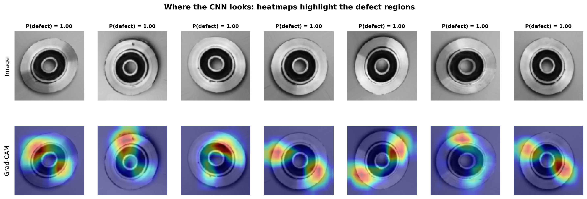
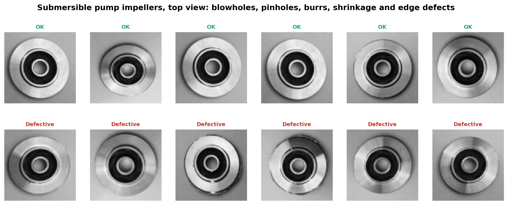
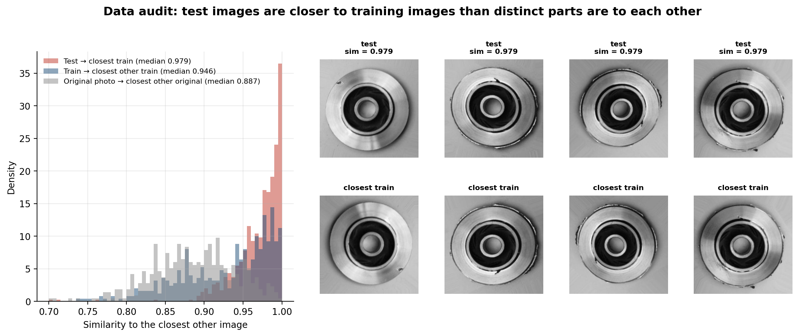
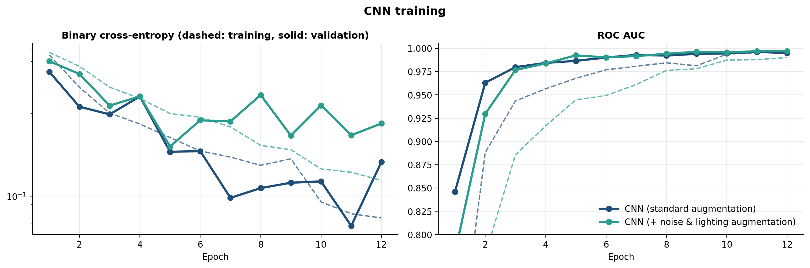
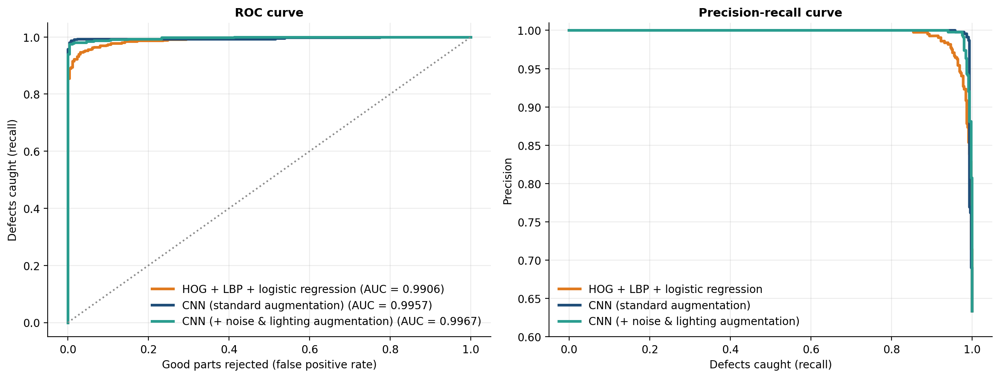
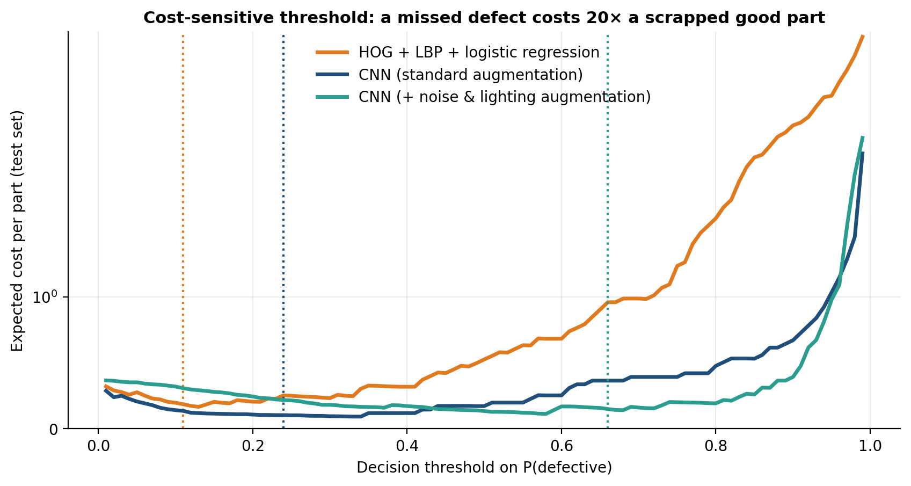
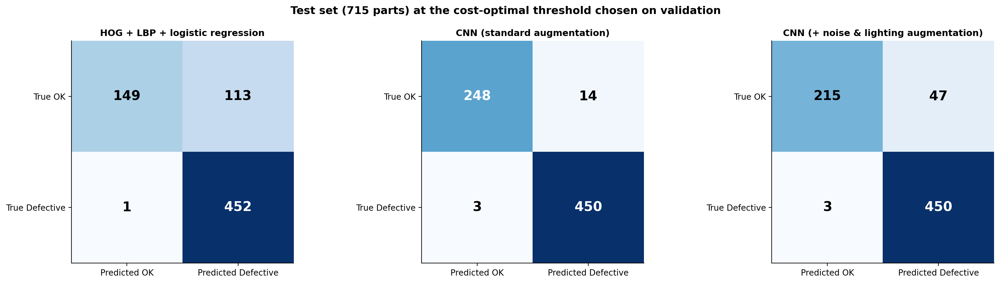
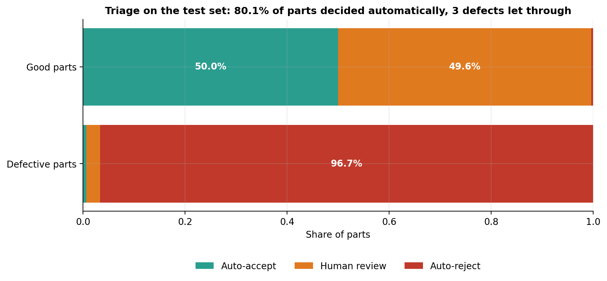
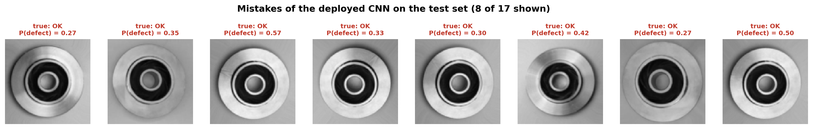
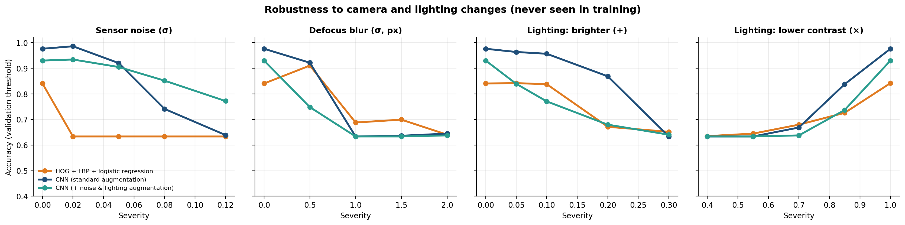

# Visual Quality Inspection of Cast Parts with Deep Learning

**Computer vision · CNNs · Cost-sensitive classification · Human-in-the-loop triage · Grad-CAM · Robustness evaluation**

Casting defects such as blowholes, pinholes, burrs, and shrinkage can be difficult to identify consistently through manual inspection. This project investigates automated visual inspection of submersible pump impellers using top-view images and convolutional neural networks (CNNs).

The evaluation goes beyond classification accuracy. It examines the cost of different types of errors, the use of human review for uncertain predictions, the reliability of the test set, and the effects of changes in image quality caused by lighting, sensor noise, and defocus.



## Key Results

The test set contains 715 images: 453 defective parts and 262 good parts. Decision thresholds are selected using validation data under an asymmetric cost assumption: **letting a defective part pass costs 20 times more than rejecting a good part**.

| Model | ROC AUC | Accuracy | Defects caught | Good parts passed |
|---|---:|---:|---:|---:|
| HOG + LBP + logistic regression | 0.991 | 84.1% | 99.8% | 56.9% |
| CNN with standard augmentation | 0.996 | 97.6% | 99.3% | 94.7% |
| CNN with stronger noise and lighting augmentation | 0.997 | 93.0% | 99.3% | 82.1% |

Main findings:

- **Classification performance:** The standard CNN correctly classifies 97.6% of the test images and passes 94.7% of good parts. Compared with the classical vision baseline, it reduces the number of good parts rejected from 113 to 14 while detecting 450 of the 453 defective parts.
- **Human-in-the-loop triage:** A three-way decision policy automatically accepts or rejects approximately 80% of parts and sends the remaining 20% for human inspection. In the reported evaluation, three defective parts pass through and one good part is rejected.
- **Test-set limitations:** The data audit reveals substantial similarity between test images and training images. The reported test metrics should therefore not be interpreted as evidence of equivalent performance on previously unseen physical parts.
- **Sensitivity to image quality:** A one-pixel blur or a 30% reduction in contrast severely degrades all evaluated models, in some cases producing behavior comparable to rejecting every part. Robustness augmentation improves performance for some simulated conditions, but does not eliminate the need for controlled image acquisition.

## Dataset

The project uses the [Casting Product Image Data for Quality Inspection dataset](https://www.kaggle.com/datasets/ravirajsinh45/real-life-industrial-dataset-of-casting-product), published by R. Dabhi on Kaggle.

The images depict submersible pump impellers against a consistent background. The public dataset contains 7,348 augmented grayscale images at 300 × 300 pixels, split into training and test sets, along with 1,300 original images at 512 × 512 pixels from which the augmented images were derived.



## Data Audit: How Reliable Is the Test Set?

A test set is useful only if it provides a meaningful estimate of performance on data the model has not already encountered. To investigate this, the project compares each image with its closest training image after removing the shared impeller shape and accounting for rotations and flips.

The median similarity between test images and their closest training images is **0.979**, compared with **0.946** among training images and **0.887** between distinct original photographs.

These results indicate that the published split contains substantial image-level similarity. Because training and test images originate from the same augmented image pool, the test metrics may overestimate performance on new physical parts. A more representative evaluation would split the data by original photograph or, preferably, by independently photographed parts.



## Models

Three approaches are evaluated.

- **Classical computer vision:** Histogram of Oriented Gradients (HOG) features capture shape and edge information, while Local Binary Patterns (LBP) describe local texture. The extracted features are passed to a logistic regression classifier.
- **CNN with standard augmentation:** A CNN trained from scratch using four convolutional blocks, approximately 98,000 parameters, group normalization, global average pooling, and dropout. Inputs are resized to 96 × 96 pixels. Augmentation includes random rotations, flips, and brightness and contrast adjustments.
- **CNN with stronger robustness augmentation:** The same architecture, trained with more substantial lighting variations and Gaussian sensor noise.

An implementation detail emerged during training. With batch normalization, validation accuracy fluctuated sharply between epochs, ranging from 43% to 98%. Replacing batch normalization with group normalization stabilized training under the chosen augmentation setup.





## From Model Scores to Inspection Decisions

Classification scores do not determine how a model should be used in production. The decision threshold must also reflect the relative costs of false negatives and false positives.

Here, a defective part that passes inspection is assigned a cost 20 times higher than that of rejecting a good part. The threshold that minimizes estimated expected cost is selected on the validation set and then applied unchanged to the test set.





### Human-in-the-loop triage

Instead of requiring a binary decision for every image, the triage policy uses two thresholds selected on validation data:

- **Automatic acceptance:** Parts with scores below the lower threshold are accepted, subject to a validation target that limits the proportion of defective parts accepted automatically to 0.2%.
- **Automatic rejection:** Parts with scores above the upper threshold are rejected, subject to a validation target that limits the proportion of good parts rejected automatically to 1%.
- **Human inspection:** Parts between the thresholds are referred to an inspector.

This policy reserves manual inspection for uncertain cases while allowing more confident predictions to be handled automatically. The resulting coverage and error rates depend on the selected thresholds and should be validated on independently collected production data before deployment.



## Model Explanations and Classification Errors

Grad-CAM is used to visualize image regions that contribute to the CNN's predictions. The resulting heatmaps provide a qualitative view of the model's attention and can help identify whether predictions appear to rely on defect regions or potentially misleading visual cues.

These visualizations are diagnostic tools, not proof that the model has learned the correct defect characteristics.


Of the 17 classification errors made by the standard CNN, 14 are good parts incorrectly flagged as defective. Under the assumed cost structure, these false positives are less expensive than allowing defective parts to pass, although their frequency still matters for production efficiency.



## Robustness to Camera and Lighting Changes

The models are evaluated on test images subjected to simulated image-quality degradations that the standard model did not encounter during training.



The main observations are:

- **Sensor noise:** Stronger noise augmentation improves accuracy at high noise levels. At a noise standard deviation of \(\sigma = 0.12\), the robust CNN reaches 77% accuracy, compared with 64% for the standard CNN. The classical baseline degrades substantially under noise.
- **Defocus and contrast loss:** All models are highly sensitive to these changes. A one-pixel blur can remove fine surface details that help distinguish pinholes from clean surfaces.
- **Increased brightness:** The standard CNN performs better than the heavily augmented variant in this condition, showing that stronger augmentation does not necessarily improve robustness to every type of shift.

These experiments use simulated degradations and do not cover every variation that may occur in a production environment. The results nevertheless highlight the importance of consistent lighting, fixed focus, and periodic image-quality checks as part of the inspection process.

## Project Structure

```text
├── config.py                  # Image size, error costs, and triage targets
├── train.py                   # CNN training (--robust for the augmented variant)
├── evaluate.py                # Metrics, decisions, audit, robustness, and figures
├── scripts/
│   └── download_data.py       # Dataset download
├── src/
│   ├── data.py                # File indexing and image loading
│   ├── models.py              # CNN and HOG + LBP baseline
│   ├── decision.py            # Cost-sensitive thresholding and triage
│   ├── duplicates.py          # Similarity search for the data audit
│   ├── explain.py             # Grad-CAM visualizations
│   ├── perturb.py             # Noise, blur, and lighting degradations
│   └── plots.py               # Figures
├── tests/
│   └── test_core.py
├── figures/
└── results/
```

## How to Run

Create a virtual environment, install the dependencies, and download the dataset:

```bash
python -m venv .venv

# Linux/macOS
source .venv/bin/activate

# Windows PowerShell
.\.venv\Scripts\Activate.ps1

pip install -r requirements.txt
python scripts/download_data.py
```

The dataset download requires Git and approximately 150 MB of storage.

Train and evaluate the models:

```bash
# Standard CNN
python train.py

# CNN with stronger robustness augmentation
python train.py --robust

# Generate evaluation metrics and figures
python evaluate.py

# Run tests
pytest
```

On the reference setup, training takes approximately 11 minutes for the standard CNN and 14 minutes for the robust variant on a single CPU core. Evaluation takes approximately four minutes. Actual runtimes depend on the hardware and configuration.

## Limitations and Next Steps

The results should be interpreted in light of several limitations:

- **Limited evidence of generalization:** The published split does not establish performance on independently photographed parts. A new evaluation should separate original parts or acquisition sessions across training and test sets.
- **Restricted image conditions:** Only top-view images of one product type under relatively stable conditions are evaluated. Other viewpoints, products, cameras, and production environments remain untested.
- **Sensitivity to image quality:** The robustness experiments show that relatively small changes can substantially affect classification performance.
- **Threshold dependence:** The cost-sensitive decisions and triage targets depend on the assumed error costs and validation distribution. Both should be reassessed for the intended production environment.

Potential next steps include transfer learning with a pretrained backbone, augmentation strategies that include blur and contrast degradation, anomaly detection trained only on good parts, and probability calibration to support more reliable threshold selection.

## References

- R. Dabhi, “Casting Product Image Data for Quality Inspection,” Kaggle, 2020.
- R. R. Selvaraju et al., “Grad-CAM: Visual Explanations from Deep Networks via Gradient-based Localization,” *Proceedings of ICCV*, 2017.
- Y. Wu and K. He, “Group Normalization,” *Proceedings of ECCV*, 2018.
- N. Dalal and B. Triggs, “Histograms of Oriented Gradients for Human Detection,” *Proceedings of CVPR*, 2005.

## Author

**Evelyn Natalie Aguiar de Almeida**

Mechanical Engineer · M.Sc. in Computer Science · Ph.D. Student in Computer Science